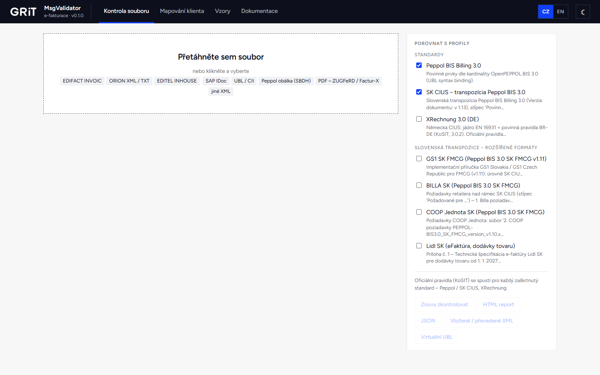
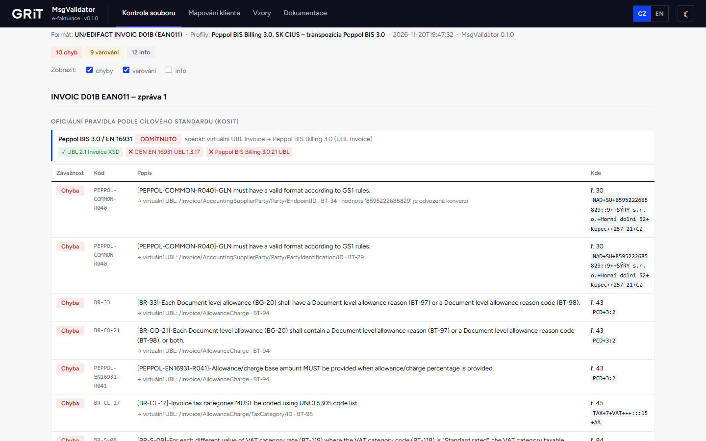
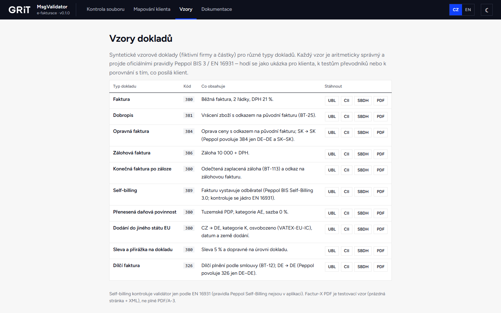

# MsgValidator – eInvoicing

[CZ](#cz) · [EN](#en)



## CZ

**Co to je:** lokální validátor a gap analýza e-faktur. Přetáhnete soubor, nástroj rozpozná formát a ukáže, co oproti cílovému standardu chybí, co se musí odvodit a co nesedí.

**Formáty:** EDIFACT INVOIC (D.96A, D.01B), ORION XML / TXT, EDITEL INHOUSE, SAP IDoc, UBL / CII, Peppol SBDH, PDF ZUGFeRD / Factur-X, neznámé XML (odhad mapování).

**Cíle:** Peppol BIS 3.0, EN 16931, SK CIUS, XRechnung a retailer profily (GS1 SK FMCG, BILLA, COOP, Lidl).

**Proč:**
- konec dohadů „sedí tenhle vzorek na specifikaci?“ – odpověď za pár sekund, po jednotlivých BT
- oficiální pravidla (KoSIT, CEN, Peppol) i nad ne-XML formáty přes „virtuální UBL“
- mapování klienta (SAP IDoc, vlastní XML) naklikáte bez programování
- vše běží lokálně, soubory nikam neodcházejí

## EN

**What:** a local e-invoice validator and gap analysis. Drop a file, it detects the format and shows what is missing against the target standard, what has to be derived and what is wrong.

**Formats:** EDIFACT INVOIC (D.96A, D.01B), ORION XML / TXT, EDITEL INHOUSE, SAP IDoc, UBL / CII, Peppol SBDH, PDF ZUGFeRD / Factur-X, unknown XML (mapping guess).

**Targets:** Peppol BIS 3.0, EN 16931, SK CIUS, XRechnung and retailer profiles (GS1 SK FMCG, BILLA, COOP, Lidl).

**Why:**
- no more guessing whether a sample matches the spec – answer in seconds, per business term
- official rules (KoSIT, CEN, Peppol) even for non-XML formats via a "virtual UBL"
- client mappings (SAP IDoc, custom XML) built by clicking, no coding
- runs locally, files never leave your machine

## Screenshots

| | |
|---|---|
|  Official rules (KoSIT) |  Gap analysis vs. profiles |
|  Client mapping |  Sample documents |

## Run

```powershell
pip install -e .
python -m msgvalidator                      # UI in browser
python -m msgvalidator check invoice.edi    # text report
.\build.ps1                                 # -> dist\MsgValidator.exe (pip install -e .[dev])
```

License: AGPL-3.0
